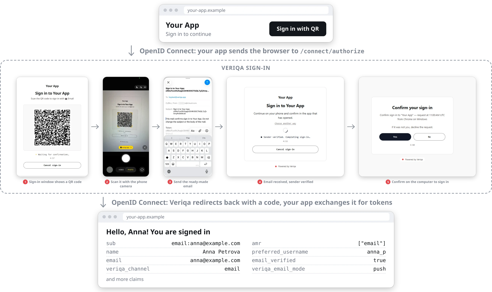
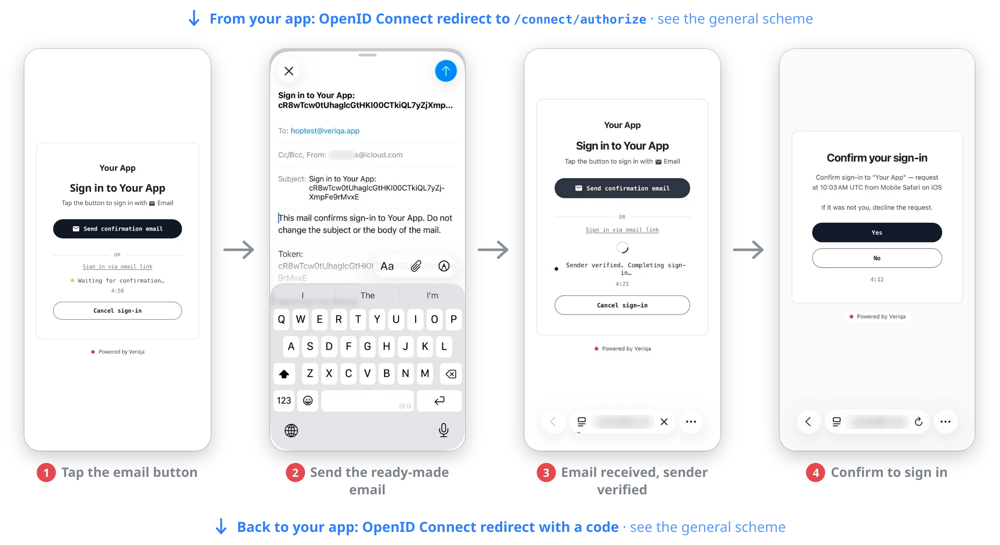

# Email passwordless login for Python, Node.js, Go, PHP and ASP.NET Core — OpenID Connect (OIDC)

Email sign-in with no password, for a Python, Node.js, Go, PHP or ASP.NET Core app, over standard OpenID
Connect (OIDC). The provider is [Veriqa](https://veriqa.app), open source, and you run it yourself. A sign-in can go three ways: a one-tap email, a code from an email or a magic link.

**We recommend trying [one-tap email](#try-one-tap-email) first.** Your users scan the QR code on the sign-in page (on a
phone, they tap a button) and send a ready-made email.

- **Better for your users:** they don't wait for anything to arrive. The email travels from them to you, so a spam
  folder or a slow delivery can't stop the sign-in, and it works the way messaging apps do.
- **Better for security:** a link or a code shows only that your email reached someone, including through a forwarding rule or a
  shared mailbox. Sending an email shows that the sender controls the mailbox, and Veriqa checks the sender
  against DMARC by default.

<p align="center">
  <br />
  <sub>One-tap email on a computer: a QR code, the phone camera, a ready-made email, one tap on the confirmation page.</sub>
</p>

<p align="center">
  <br />
  <sub>One-tap email on a phone: a channel button, a ready-made email, one tap on the confirmation page.</sub>
</p>

The stand starts with the magic link, because it runs without any mail account. One-tap email needs a mailbox for
incoming email, and it takes [a few settings](#try-one-tap-email) to turn on. The code takes
[one setting](#sign-in-with-a-code).

| Way to sign in | What the user does | What it needs | On this stand |
| --- | --- | --- | --- |
| One-tap email | scans the QR code or taps a button, then sends a ready-made email | a mailbox for incoming email | [your mailbox settings](#try-one-tap-email) |
| Code | enters an address, then the six-digit code from the email | outgoing mail | [`EMAIL_PULL_METHOD=Code`](#sign-in-with-a-code) |
| Magic link | enters an address, then opens the link from the email | outgoing mail | on by default |

## What you get

This is what the stand does out of the box. Open the client app and it sends you to the sign-in page. You enter your email address, a letter
with a magic link arrives, you open the link and confirm — and you are back in the app, signed in,
looking at the claims the provider issued. No password and no SMS code.

Out of the box nothing leaves your machine: the letters go to [Mailpit](https://mailpit.axllent.org/),
a local mail catcher with a web inbox, so the stand works without any mail account. Point it at a
real SMTP server when you want real mail.

The provider is [Veriqa](https://veriqa.app): an open-source OpenID Connect provider built on
OpenIddict that confirms sign-ins in messaging apps — Telegram, WhatsApp, Instagram, Messenger,
WeChat, Viber, other channels or Email. Email is the channel for users without a messaging app. The clients know nothing about Veriqa: each one uses a stock OpenID
Connect library for its language (Authorization Code + PKCE), so the same setup works for any stack
with an OIDC library.

Each folder next to `clients/` is one way to connect Email, with a stand of its own; they share the client apps
in `clients/`. `built-in/` uses the Email channel built into Veriqa.

```
built-in/            the stand with the Email channel built into Veriqa
  docker-compose.yml   Veriqa from the published image, Email channel only, and Mailpit
  .env.example         the values you fill in
clients/             the client app, one per language - run any of them
  python/              Flask, Authlib
  node/                Express, openid-client, in TypeScript
  go/                  net/http, go-oidc
  php/                 jumbojett/openid-connect-php
  dotnet/              ASP.NET Core, Microsoft.AspNetCore.Authentication.OpenIdConnect
```

## Before you start

- [Docker](https://docs.docker.com/get-docker/) with Compose: the stand runs in it for simplicity. Veriqa also runs
  without Docker, [as an OS service](https://veriqa.app/docs/quickstart/os-service)
- the runtime of the client you pick: Python 3.10+, Node.js 24.5+, Go 1.26+, PHP 8.2+ with
  [Composer](https://getcomposer.org/), or the [.NET SDK 10](https://dotnet.microsoft.com/download)

That is all: no mail account and no public address are needed.

## Run it

**1. Fill in the settings.**

```bash
cd built-in
cp .env.example .env
```

Pick any password for `CERT_PASSWORD`. Leave the `SMTP_*` variables empty to use Mailpit.

**2. Create the HTTPS certificate.** OpenID Connect needs HTTPS even locally: the provider serves
it at `https://localhost:8443`.

For the Python, Node.js, Go and PHP clients, let the stand create a self-signed certificate:

```bash
docker compose run --rm certificate
```

The clients find it in `certs/` on their own. Your browser warns about it when the sign-in page first
opens: choose to proceed.

For the ASP.NET Core client, use the .NET development certificate, which also serves the client at
`https://localhost:7020`:

```bash
dotnet dev-certs https --trust
dotnet dev-certs https -ep certs/localhost.pfx -p <CERT_PASSWORD from .env>
chmod 644 certs/localhost.pfx
```

`--trust` makes your machine trust the certificate; on Linux follow what the command prints. The
`chmod` (Linux and macOS) lets the non-root user of the container read the file; on Windows skip it
and write the path as `certs\localhost.pfx`.

The stand holds one certificate at a time. To switch between the two kinds, delete `certs/` first (with
`sudo` on Linux, the container created it) and create the provider again with `docker compose up -d --force-recreate`.

**3. Start the provider.**

```bash
docker compose up -d
docker compose ps
```

Wait until the `veriqa` service reads `healthy`, then check that it is ready:
`https://localhost:8443/health/ready` answers `200`.

**4. Start the client.**

Python:

```bash
cd ../clients/python
python3 -m venv .venv
.venv/bin/pip install -r requirements.txt
.venv/bin/python main.py
```

On Windows, run `python -m venv .venv`; the virtual environment's programs are in `.venv\Scripts\`.

Node.js:

```bash
cd ../clients/node
npm install
npm start
```

Go:

```bash
cd ../clients/go
go run .
```

PHP:

```bash
cd ../clients/php
composer install
php -S localhost:7020 index.php
```

ASP.NET Core:

```bash
dotnet run --project ../clients/dotnet -- --Oidc:Channel email
```

**5. Sign in.** Open `http://localhost:7020` (`https://` for the ASP.NET Core client) and enter any email address. Open the Mailpit inbox
at `http://localhost:8025`, open the letter and click the link, then confirm. You land back on the
client with the list of your claims. `/signout` drops the local session so you can go again.

The link in the letter points at `https://localhost:8443`, so open it on the same machine. On a
deployed server the link carries its public address and opens anywhere, the phone included.

## Real mail instead of Mailpit

Set the SMTP variables in `.env` and restart with `docker compose up -d`:

| Variable | Value |
| --- | --- |
| `SMTP_HOST`, `SMTP_PORT` | your mail server; `587` for STARTTLS, `465` for implicit TLS |
| `SMTP_USE_SSL` | `false` on `587`, `true` on `465` |
| `SMTP_USERNAME`, `SMTP_PASSWORD` | set both or neither |
| `EMAIL_FROM_ADDRESS` | the sender address your server may send from |

## Sign in with a code

Set `EMAIL_PULL_METHOD=Code` in `.env` and restart with `docker compose up -d`. The email now carries a code instead
of a link, and the user enters it on the page where they typed the address.

The code has six digits and allows five attempts. It stays valid for five minutes, and a new email invalidates the previous
code. An email can also carry both the link and the code:
[Link, code or both](https://veriqa.app/docs/guides/channels#link-code-or-both).

## Try one-tap email

You need a mailbox that Veriqa can read over IMAP. Give it a mailbox of its own: Veriqa marks every recent unread
email in it as read.

Add these lines to the `environment` section of the `veriqa` service in `built-in/docker-compose.yml`, with the values of your
mailbox, put `IMAP_PASSWORD` into `.env` and restart with `docker compose up -d`:

```yaml
      Veriqa__Channels__Email__PushEnabled: "true"
      Veriqa__Channels__Email__PreferredMode: Push
      Veriqa__Channels__Email__InboundVerification: outbound_fetch
      Veriqa__Channels__Email__Inbound__Provider: ImapPolling
      Veriqa__Channels__Email__Inbound__InboundAddress: login@your-domain.com
      Veriqa__Channels__Email__Inbound__Imap__Host: imap.your-provider.com
      Veriqa__Channels__Email__Inbound__Imap__Username: login@your-domain.com
      Veriqa__Channels__Email__Inbound__Imap__Password: "${IMAP_PASSWORD:?set IMAP_PASSWORD in .env}"
      Veriqa__Channels__Email__Inbound__Imap__AuthservId: mx.your-provider.com
```

`AuthservId` is the name your mail server writes at the start of the `Authentication-Results` header; open the source of
any email in the mailbox to find it. Details, and which mailboxes won't work:
[One-tap email over IMAP](https://veriqa.app/docs/guides/channels#one-tap-email-over-imap).

If the header has no such name or no DMARC verdict, the sender check fails and the sign-in request expires. Such a mailbox
can work with `VerificationPolicy: AllowListOnly` and `AllowedDomains`, but then Veriqa checks only the domain in `From` and
relies on your mail server to reject forged senders.

The sign-in page now shows the QR code and the **Send confirmation email** button, and it keeps the email link as a
fallback. The QR code opens a ready-made email on the phone, so it works on this local stand too.

## Worth a closer look

- **A link doesn't sign anyone in by itself.** The page it opens passes the sign-in on to the window where it started,
  and that window asks **Yes** or **No**. A mail gateway that follows the link changes nothing: only the page's button
  does. See [The emailed-link page](https://veriqa.app/docs/guides/channels#the-emailed-link-page).
- **The link page compares browsers, including the IP address.** In
  [hop mode](https://veriqa.app/docs/reference/configuration#veriqahopmode), with `HopMode.CollectFingerprint` on, the
  sign-in keeps the browser fingerprint and the IP address of the phone that scanned the QR code. If the browser that
  opens the link has the same fingerprint and IP address, the page continues without its button; any mismatch leaves
  the button in place. The check only saves a tap and blocks nobody. This stand doesn't use hop mode.
- **A forged verdict in an email doesn't pass.** A sender can write their own `Authentication-Results` header into an
  email, so one-tap email trusts only the topmost header with the `AuthservId` of your mail server. With no such header,
  the sender check fails.

## How it fits together

- `clients/dotnet/` asks the provider for a sign-in with `acr_values=channel:email`, so the sign-in page goes
  straight to Email. Without `--Oidc:Channel` it offers every enabled channel. The
  other clients take the same value from the `VERIQA_CHANNEL` variable; this stand enables one channel,
  so they run without it.
- `built-in/docker-compose.yml` registers the client (`rp`, redirects `http://localhost:7020/signin-oidc`
  and `https://localhost:7020/signin-oidc`), sets the issuer to `https://localhost:8443` and enables the
  Email channel. `EMAIL_PULL_METHOD` sets what the sign-in email carries, the magic link by default.
- The stand runs in the `Development` environment: sessions live in memory and tokens are signed
  with development certificates, so a restart forgets everything — it is a local stand, not a
  deployment.

## Going further

- Email channel settings and how to choose a mode:
  [Which mode to choose](https://veriqa.app/docs/guides/channels#which-mode-to-choose).
- A production setup with a database, real certificates and a reverse proxy:
  [Quickstart self-hosted](https://veriqa.app/docs/quickstart/self-hosted).
- Veriqa itself — the source, the other samples and the documentation:
  [gitlab.com/veriqa/veriqa](https://gitlab.com/veriqa/veriqa) · [veriqa.app](https://veriqa.app).

## License

This sample is MIT-licensed — copy it into your own code freely. Veriqa itself is open source under
MPL-2.0.
